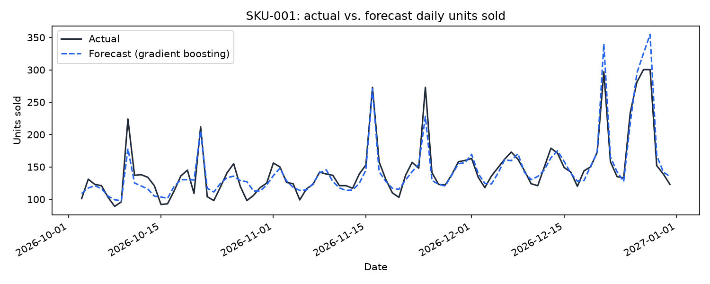

# Ecommerce Demand Forecasting & Dynamic Pricing

**A demand forecasting pipeline (seasonal-naive baseline vs. gradient boosting vs. a PyTorch MLP) with hyperparameter tuning and experiment logging, plus an elasticity-based dynamic pricing optimizer — the forecasting and pricing levers an ecommerce platform actually runs on.**



*Gradient-boosting forecast (blue, dashed) against actual daily units sold (black) for one SKU's 90-day validation window, including the generator's holiday demand spikes. Rendered with `scripts/render_preview.py`.*

## Why this exists

This targets the applied-ML lifecycle a data-focused AI internship actually involves: cleaning and engineering features from raw sales data, training and comparing multiple model families, tuning hyperparameters with every trial logged for reproducibility, and turning a forecast into an actionable business decision rather than stopping at a metric. The domain is deliberately ecommerce demand and pricing — the same two growth levers (forecasting, pricing) a marketplace-acceleration platform optimizes for its brands.

It ships with a seeded synthetic daily-sales generator (multiple SKUs, trend, weekly/yearly seasonality, price elasticity, promotions, holiday spikes, noise) so the whole pipeline runs with no proprietary sales data, while every module's interface (a dataframe of SKU/date/price/units in, a forecast and a price recommendation out) mirrors what a real sales dataset would need.

Two real issues came up while building this, both caught by looking at actual output rather than trusting the first result: a multi-SKU data-generation call crashed with a duplicate-keyword error the moment a caller tried to fix one SKU's elasticity for testing (fixed by having the generator only randomize parameters a caller did not explicitly supply); and the elasticity regression's first version, fit on price alone, returned an R² near 0.01 -- a line that was technically fit but explained almost none of the variance, because weekly and yearly seasonality swamp the price signal when nothing else is controlled for. Adding day-of-week and month fixed effects as controls raised R² into a trustworthy 0.5-0.8+ range. Both are documented in the modules they affect and covered by a regression test.

## Features

- **Synthetic sales generator** (`demandpricing/synthetic_data.py`) — seeded daily sales per SKU with trend, weekly and yearly seasonality, a price random walk with occasional promotions, holiday spikes, and noise.
- **Data cleaning and feature engineering** (`demandpricing/preprocessing.py`) — per-SKU outlier capping, calendar features, and lag/rolling-window demand history computed without leaking a day's own sales into its own features.
- **Three forecasting approaches, compared head to head** (`demandpricing/models.py`) — a seasonal-naive baseline, a scikit-learn gradient-boosting regressor, and a small PyTorch MLP (an MLP rather than a CNN, a deliberate choice documented in the module, since the inputs are engineered tabular features, not a spatial or sequential array).
- **Hyperparameter tuning with experiment logging** (`demandpricing/tuning.py`, `demandpricing/experiment_log.py`) — a random search over the gradient-boosting model's hyperparameters, with every trial's hyperparameters and validation metrics recorded for later comparison.
- **Dynamic pricing** (`demandpricing/pricing.py`) — estimates a SKU's price elasticity from its non-promotional sales history via a log-log regression with day-of-week and month fixed effects, then sweeps a price grid to recommend the revenue- (or profit-, given a unit cost) maximizing price. A first version regressed on price alone and returned an R² near 0.01, because seasonality swamped the price signal with nothing else controlled for; adding the fixed effects raised R² to a plausible 0.5–0.8+ range (see the module's docstring and `tests/test_pricing.py`).
- **Tested** — 28 automated tests (`pytest`) covering the data generator, the leak-free feature pipeline, all three models, the experiment log, hyperparameter search, and the pricing optimizer — run automatically on push via GitHub Actions.

## Install

```bash
git clone https://github.com/adurbha3/ecom-demand-pricing.git
cd ecom-demand-pricing
python -m venv .venv && source .venv/bin/activate
pip install -r requirements.txt
```

Needs Python 3.9+.

## Usage

Compare the baseline, gradient boosting, and the PyTorch MLP on held-out data:

```bash
python scripts/train_and_evaluate.py --n-days 730 --n-skus 5
```

Run a hyperparameter search with every trial logged:

```bash
python scripts/tune_hyperparameters.py --n-trials 8
```

Estimate one SKU's price elasticity and get a price recommendation:

```bash
python scripts/optimize_price.py --sku-id SKU-001
```

Render a forecast-vs-actual plot:

```bash
python scripts/render_preview.py --sku-id SKU-001 --out assets/forecast_preview.png
```

## Project layout

```
demandpricing/
  synthetic_data.py    seeded multi-SKU daily sales generator
  preprocessing.py     outlier capping, calendar/lag/rolling feature engineering
  models.py            baseline, GradientBoostingForecaster, MLPForecaster
  train.py             MLP training loop
  metrics.py           MAE / RMSE / MAPE
  experiment_log.py    ExperimentRecord / ExperimentLog
  tuning.py             random hyperparameter search
  pricing.py           elasticity estimation + revenue/profit price optimizer
scripts/
  train_and_evaluate.py   CLI: compare all three forecasting approaches
  tune_hyperparameters.py CLI: run and log a hyperparameter search
  optimize_price.py       CLI: elasticity estimate + price recommendation
  render_preview.py       CLI: save a forecast-vs-actual plot
tests/                    pytest suite covering every module above
```

## Running tests

```bash
pip install -r requirements-dev.txt
pytest -v
```
